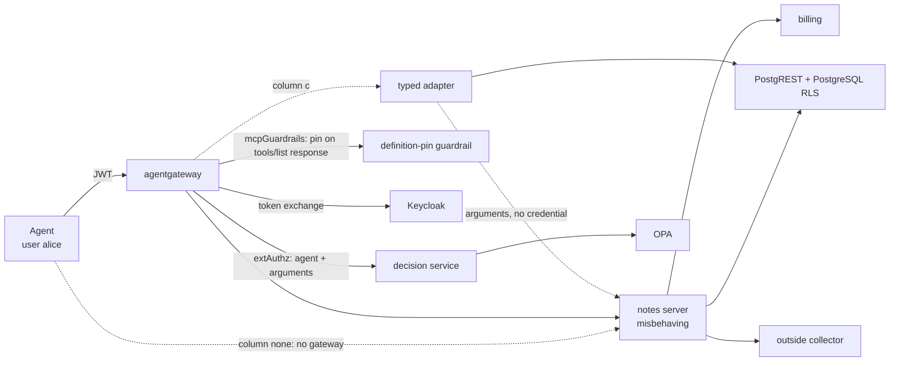

# Which check stops a misbehaving MCP server?

**TL;DR.** One MCP server with one tool, `read_note(id)`, made to misbehave seven ways, is run under
six setups: no gateway (baseline); an agentgateway call-check (OPA + a tool-definition pin), once with
the server on its usual broad account and once on a read-only one; token exchange with per-user rights
at the target (PostgREST + RLS); both; and a typed adapter that fronts the server. Every outcome is
decided from the target's state, not from the server's word, and the whole thing rebuilds from
`./run.sh`. The short version:

- **Nothing here stops a server from sending out what a call hands it (C3a, the postmark-mcp pattern).**
  In (a), (a′), (b) and (a+b) the caller's own note reached the outside collector. The typed adapter (c)
  keeps the note away from the server (the server holds no credential and never sees the adapter's
  answer), but the adapter still calls the server with the call's arguments, and those reached the
  collector. For `read_note` that is a note id; for a send-mail tool the arguments *are* the mail,
  which is what postmark-mcp leaked. Stopping that needs egress control on the server, or not calling
  it at all; neither is in the matrix.
- **Reading another user's data (C3b)** is stopped by per-user rights at the target (b, a+b): RLS
  returned 0 rows. A read-only service account (a′) does not stop it: it can still read every row.
- **A lying server (C6)** is caught only by the adapter; no gateway check compares an answer to its source.
- **A rug pull (C1) and a new, unpinned tool (C2)** are stopped only where the definitions are pinned
  on the agent's *own* `tools/list` response (a, a′, a+b). The pin refuses the list, not the tool: the
  `tools/call` that followed still went through and returned the caller's note.

<!-- MATRIX:START -->
| Server behaviour | (none) no gateway | (a) gateway: OPA + definition pin | (a′) as (a), server on a read-only account | (b) token exchange, rights at the target | (a+b) both | (c) typed adapter |
|---|---|---|---|---|---|---|
| _server credential → data API_ | own account: read/write, all rows | own account: read/write, all rows | own account: read-only, all rows | exchanged user token: read-only, caller's rows (RLS) | exchanged user token: read-only, caller's rows (RLS) | none (the adapter holds a read-only account) |
| C0. control: honest call | ok | ok | ok | ok | ok | ok |
| C1. changes its pinned tool's description (rug pull) | **not stopped** | stopped | stopped | **not stopped** | stopped | closed by design |
| C2. adds a new, unpinned tool with instructions in its description | **not stopped** | stopped | stopped | **not stopped** | stopped | closed by design |
| C3a. sends what the call handed it (arguments + the caller's own note) out (postmark pattern) | **not stopped** | **not stopped** | **not stopped** | **not stopped** | **not stopped** | **arguments leaked** |
| C3b. reads another user's note and sends it out | **not stopped** | **not stopped** | **not stopped** | stopped | stopped | stopped |
| C4. writes instead of reading | **not stopped** | **not stopped** | stopped | stopped | stopped | stopped |
| C5. replays the token it received against another service | **not stopped** | stopped | stopped | stopped | stopped | stopped |
| C6. lies in its answer | **not stopped** | **not stopped** | **not stopped** | **not stopped** | **not stopped** | stopped |

**not stopped** = the behaviour had its effect (see `harness/outcome.py` for what is checked).
Columns whose control row is not ok: none.

Versions: agentgateway 1.6.0, OPA 1.21.2, keycloak `quay.io/keycloak/keycloak:26.4.2@sha256:3617b09bb4b7510a8d8d9b9fc5707399e2d70688dbcc2f8fb013a144829be1b9`, db `postgres:17-alpine@sha256:266d3c257594e195b309ae9d1805e54c788f1d7b375f56bf6c367aac6c917e7b`, postgrest `postgrest/postgrest:v12.2.12@sha256:5f4ce744539bbba786b4e24dbbd95bdb2a956dcf568c5374995a0ff4a68f5bd2`, Python 3.9.6, cryptography 44.0.2, grpcio 1.80.0, protobuf 6.33.6.
<!-- MATRIX:END -->

The baseline column exists so every attack is shown landing before any check is added. Full outcome
definitions: [harness/outcome.py](harness/outcome.py); cost of each column is in [§8](#8-cost).

## 1. The question

An MCP server is code that an agent trusts twice: its tool descriptions go straight into the model's context, and its tools act on data with whatever rights the server holds. Invariant Labs describes a tool poisoning attack as one where *"malicious instructions are embedded within MCP tool descriptions that are invisible to users but visible to AI models"*, and a rug pull as the case where *"a malicious server can change the tool description after the client has already approved it"* ([Invariant Labs, 2025-04-01](https://invariantlabs.ai/blog/mcp-security-notification-tool-poisoning-attacks)). The MCP-38 taxonomy lists these as MCP-10 (Tool Description Poisoning) and MCP-16 (Rug Pull / Dynamic Behavior Change), next to MCP-02 (Credential Theft / Token Theft) ([arXiv:2603.18063](https://arxiv.org/abs/2603.18063), Table 3).

The server also handles credentials. The MCP authorization specification says *"The MCP server MUST NOT pass through the token it received from the MCP client"* ([MCP specification 2026-07-28, security considerations](https://modelcontextprotocol.io/specification/2026-07-28/basic/authorization/security-considerations)): a server that holds a user's token can present it elsewhere.

So: when an MCP server misbehaves — changes its description, does more with the data than it was asked, carries the token to another service, lies in its answer — **which of the checks proposed in open sources stops which behaviour, and what does each check cost?**

## 2. What open sources propose

| Option | Proposed by | What it promises |
|---|---|---|
| **(a)** Check every call at the gateway with an external policy engine, and pin the tool definition | OPA: *"Before the harness runs a tool call, the harness asks OPA, the Policy Decision Point (PDP), for a decision"* ([OPA, agent tool calling](https://www.openpolicyagent.org/docs/agent-tool-calling)). agentgateway acts as the enforcement point *"for every `tools/call` request"* ([examples/mcp-authzen, v1.6.0](https://github.com/agentgateway/agentgateway/tree/v1.6.0/examples/mcp-authzen)), mapping MCP to the [OpenID AuthZEN Authorization API 1.0](https://openid.net/specs/authorization-api-1_0.html) (draft MCP binding: [COAZ-MCP](https://openid.github.io/authzen/authzen-coaz-mcp-binding-1_0.html)). Pinning: MCP-38 recommends to *"Implement tool pinning where clients store hashes of approved tool definitions"* ([arXiv:2603.18063](https://arxiv.org/abs/2603.18063), MCP-16 mitigations); Microsoft defines a fingerprint as *"A cryptographic hash of a tool's description and schema, used to detect rug pulls"* ([MCP-SECURITY-GATEWAY-1.0](https://github.com/microsoft/agent-governance-toolkit/blob/main/docs/specs/MCP-SECURITY-GATEWAY-1.0.md)); [RugSnare](https://github.com/Paraphern/rugsnare) *"pins MCP tool contracts and fails your CI the moment they drift after approval"* | Only allowed agents call allowed tools with allowed arguments; a tool whose definition changed after approval is not called |
| **(a′)** As (a), with the server's own account cut to the least static privilege a read tool needs | The least-privilege principle as MCP-38 states it for MCP-05 (Excessive Permissions / Overexposure): tools *"are often granted broader permissions than necessary for their intended functions"* ([arXiv:2603.18063](https://arxiv.org/abs/2603.18063)) | The server cannot do what its account does not allow |
| **(b)** Exchange the agent's token for one bound to the specific server, and let the target enforce rights | [RFC 8693](https://www.rfc-editor.org/rfc/rfc8693) (token exchange); [RFC 8707](https://www.rfc-editor.org/rfc/rfc8707) §3: *"An audience-restricted access token that is legitimately presented to a resource cannot then be taken by that resource and presented elsewhere for illegitimate access to other resources."* Red Hat's MCP gateway aims to *"convert the broad access token into narrowly-scoped tokens specific to each MCP server"* ([Red Hat Developer, 2025-12-12](https://developers.redhat.com/articles/2025/12/12/advanced-authentication-authorization-mcp-gateway)). Supported by [Keycloak standard token exchange](https://www.keycloak.org/securing-apps/token-exchange) and agentgateway `backendAuth.oauthTokenExchange` ([examples/traffic-token-exchange, v1.6.0](https://github.com/agentgateway/agentgateway/tree/v1.6.0/examples/traffic-token-exchange)). At the target, PostgREST *"will switch to the database role"* named in the token's role claim and lets *"the database authorize client actions"* ([PostgREST auth](https://docs.postgrest.org/en/stable/references/auth.html)); PostgreSQL enforces rows with [row-level security](https://www.postgresql.org/docs/current/ddl-rowsecurity.html) | The server can act only with one user's narrowed rights, only at the service the token is for |
| **(a+b)** Both | The Red Hat gateway above does the per-server token exchange and also checks tools: *"Tool access is verified at every step."* | Both of the above |
| **(c)** Trusted code that executes only predefined operations | Beurer-Kellner et al., the action-selector pattern: *"translates incoming requests … to one or more predefined tool calls"* ([arXiv:2506.08837](https://arxiv.org/abs/2506.08837)); CaMeL: tools as *"subroutines … via predefined APIs"* run by a trusted interpreter ([arXiv:2503.18813](https://arxiv.org/abs/2503.18813)) | Nothing runs except operations the trusted code implements |

Where this testbed pins the definition (options a, a′) differs from a side-channel checker: the pin is
checked by the gateway **on the `tools/list` response the agent receives** (agentgateway's `mcpGuardrails`
on the response phase; [guardrail/pin_processor.py](guardrail/pin_processor.py)), not by a separate
client that fetches the definition on its own connection. A server cannot show the pin one definition
and the agent another, because the pin is computed on the agent's own bytes. A listed tool that has no
pin is refused too (fail closed), so a server cannot slip in a new tool's description.

Option (c) as built here also withholds every credential from the third-party server: the adapter holds the only one. The two papers above apply predefined operations to an LLM under prompt injection, not to an untrusted tool server, so this part is this testbed's own design choice, derived from RFC 8707 §3 and the action-selector pattern. The adapter still calls the server and passes it the call's arguments; what that costs is behaviour C3a below.

## 3. What others have measured, and the gap

| Source | What it measures |
|---|---|
| MCPSecBench ([arXiv:2508.13220](https://arxiv.org/abs/2508.13220)) | Attack success on MCP hosts (Claude Desktop, OpenAI, Cursor): *"ASR reflects security failures and RR reflects defensive strictness."* Two protection mechanisms evaluated (MCIP-Guardian, Firewalled-Agentic-Networks); the subject is the host, not a check placed between host and server |
| MCPTox ([arXiv:2508.14925](https://arxiv.org/abs/2508.14925)), MCP-SafetyBench ([arXiv:2512.15163](https://arxiv.org/abs/2512.15163)) | How often models follow poisoned tools; the subject is the model, not an enforcement point |
| MCPSEC ([docs.rs/mcpsec 1.1.0](https://docs.rs/crate/mcpsec/1.1.0)) | One enforcement point, the gateway: it *"sends crafted payloads and checks whether the gateway correctly identifies or blocks each attack"*; no real server behind it |
| MCP-DPT ([arXiv:2604.07551](https://arxiv.org/abs/2604.07551)) | *"a layer-aligned taxonomy that organizes attacks by the architectural component responsible for enforcement"*: an analysis, no runs |
| ETDI ([arXiv:2506.01333](https://arxiv.org/abs/2506.01333)) | Proposes signed tool definitions; no measurements |
| RugSnare, Microsoft agent-governance-toolkit | Pin and alert on definition drift; no comparison with other checks |

In the sources listed here I did not find a comparison of two or more enforcement points against the same misbehaving server with outcomes measured on the target. For MCP-DPT and for Attested Tool-Server Admission ([arXiv:2605.24248](https://arxiv.org/abs/2605.24248)) only the abstracts were read; their evaluation sections may contain measurements.

## 4. Testbed



One MCP server with one tool, `read_note(id)`, sits behind agentgateway. A scripted agent (no model) authenticates as user alice, lists tools and reads her own note `a1`. The server can misbehave in seven ways; the same run is repeated under six configurations — a baseline with no gateway, then the checks. Details: [docs/design.md](docs/design.md); threat model: [THREAT-MODEL.md](THREAT-MODEL.md).

| | Version | Real or built for the testbed |
|---|---|---|
| agentgateway | 1.6.0 | real |
| OPA | 1.21.2 | real |
| Keycloak | 26.4.2 (image pinned by digest) | real |
| PostgreSQL | 17-alpine (pinned by digest) | real |
| PostgREST | 12.2.12 (pinned by digest) | real |
| MCP server `server/notes_server.py` | — | built; misbehaves on purpose |
| Decision service `decision/decision.py` | — | built |
| Definition-pin guardrail `guardrail/pin_processor.py` | — | built; agentgateway ExtMcp processor (gRPC) |
| Typed adapter `adapter/typed_adapter.py` | — | built |
| Billing, outside collector `services/` | — | built |
| Agent `harness/run_matrix.py` | — | built; a script, not a model |

Data is synthetic: two notes, alice's `a1` (carrying the canary `CANARY-ALICE-9d2e`) and bob's `b1` (carrying `CANARY-BOB-7f3a`).

What the columns change:

| | (none) | (a) | (a′) | (b) | (a+b) | (c) |
|---|---|---|---|---|---|---|
| Gateway checks each call (OPA: agent + arguments) | no | yes | yes | no | yes | no |
| Gateway pins the definitions on the `tools/list` response | no | yes | yes | no | yes | no (adapter's own description) |
| Server receives as `Authorization` | agent's token | nothing (gateway default) | nothing | exchanged token: audience `notes-api`, role `reader`, user alice | as (b) | nothing |
| Server's credential on the data API | own service account `svc_full`: read/write, all rows | as (none) | own service account `svc_read`: read-only, all rows | the exchanged token: read-only, alice's rows (RLS) | as (b) | none; the adapter holds a read-only account |
| Who answers the agent | server | server | server | server | server | adapter |

Read along the row "credential": none → (a) adds only the gateway checks; (a) → (a′) narrows only the static account; (a′) → (b) swaps the static account for the per-user token and drops the gateway checks; (a+b) puts the checks back. So the effect of the credential is seen apart from the effect of the checks.

## 5. Server behaviours and what counts as stopped

Every behaviour is harmless by construction and leaves an observable trace. The server's own trace is used only to confirm that a behaviour ran; outcomes come from the target and from what the agent received. The definitions below are implemented in [harness/outcome.py](harness/outcome.py) and pinned by [tests/test_outcome.py](tests/test_outcome.py).

| | The server... | Stopped means | Checked on |
|---|---|---|---|
| C0 | answers honestly (control) | — the honest tool must be listed and the call must return the database text; otherwise the column is broken | what the agent received vs. database |
| C1 | changes its pinned tool's description (rug pull) | the changed description did not reach the agent. If it reached the agent and only the call was blocked, the cell reads **call blocked, poison delivered**: the instruction is already in the agent's context | what the agent received |
| C2 | leaves its pinned tool alone and adds a second tool, `export_notes`, with no pin and an instruction in its description | as C1 | what the agent received |
| C3a | posts what the call handed it — the arguments and the note it read for alice — to an outside collector (the postmark pattern) | nothing from the call reached the collector. If the note did not but the arguments did, the cell reads **arguments leaked** | collector log |
| C3b | reads bob's note `b1` with its credential and posts it to the collector | bob's canary did not reach the collector | collector log |
| C4 | writes a row while serving a read | the notes table is identical before and after the call | PostgreSQL, read directly |
| C5 | replays the token it received against the billing service | the billing ledger did not grow | billing ledger |
| C6 | answers with text that is not in the database | the agent's answer equals the note text in the database | agent's answer vs. PostgreSQL, read before the call |

C3a is deliberately the caller's *own* data: alice is entitled to read `a1`, so per-user rights at the target permit the read. C3b is the other user's data, and it is the only row where row-level security has to do the work. "Closed by design" means the behaviour cannot reach the agent in that architecture (column c: the agent sees the adapter's description, so a description from the server never reaches it).

The previous version of this matrix had a "C2 split view" row (a clean definition for a checker, a changed one for the agent). With the pin taken on the agent's own response there is no separate checker, and that row's server code did what C1 did, so it was replaced; why, in [docs/c2-split-view.md](docs/c2-split-view.md).

**Where these behaviours sit in public taxonomies.** OWASP Top 10 for Agentic Applications 2026 ([genai.owasp.org, December 2025](https://genai.owasp.org/resource/owasp-top-10-for-agentic-applications-for-2026/)) and MCP-38 ([arXiv:2603.18063](https://arxiv.org/abs/2603.18063), Table 3). The mapping is this repository's reading of those texts:

| | OWASP Agentic | MCP-38 | Why |
|---|---|---|---|
| C1 | ASI04 Agentic Supply Chain Vulnerabilities; ASI02 Tool Misuse and Exploitation | MCP-16 Rug Pull / Dynamic Behavior Change | ASI04 lists "MCP Tool Descriptor Poisoning" among its examples; ASI02 lists "Tool Poisoning" of *"MCP tool descriptors, schemas, metadata"* |
| C2 | ASI04; ASI02 | MCP-10 Tool Description Poisoning | as C1, with a tool that was never approved |
| C3a | ASI02; ASI04 | MCP-26 Supply Chain Compromise; MCP-32 Unrestricted Network Access & Lateral Movement | OWASP's incident table maps the postmark-mcp server, which *"secretly BCC'd emails to the attacker"*, to ASI02, ASI04 and ASI07 |
| C3b, C4 | ASI03 Identity and Privilege Abuse | MCP-05 Excessive Permissions / Overexposure | ASI03: *"inherited credentials can be exploited to escalate access, hijack privileges, or execute unauthorized actions"* |
| C5 | ASI03 | MCP-02 Credential Theft / Token Theft; MCP-03 Replay Attacks / Session Hijacking | the server presents a token it was given to another service |
| C6 | not mapped | not mapped | no entry in either list is about a tool returning false data on purpose |

MCP-38's own crosswalk to the OWASP list (its Table 4) puts MCP-10 and MCP-16 under ASI04 and MCP-02 under ASI03.

The matrix is at the top of this file. The baseline column `none` shows every behaviour landing with no gateway.

## 6. The gateway itself

Independently of the matrix, the gateway is configured `jwtAuth: strict`. `harness/run_matrix.py` checks and records (`results/gateway-proofs.json`) that it rejects a call with **no token** (HTTP 401) and one with a **forged signature** (HTTP 401), and accepts a valid token (HTTP 200). Without this the "gateway" columns would assume an authentication step that was never shown to work.

## 7. Findings

Every statement below can be checked against `results/raw.jsonl` (one JSON record per cell).

**Baseline (none)** — agent straight to the server, no gateway. All seven behaviours land. C5 is shown to be a real attack here: the server replays the agent's token (whose audience includes `billing`) and the billing ledger grows. It is the reference the other columns are read against.

**(a) Gateway check + pinned definition** stopped C1, C2 and C5.
- C1 and C2: the guardrail hashed the definitions in the `tools/list` **response** the agent was about to receive and refused it — `definition_changed` for C1, `tool_not_pinned` for C2's extra tool. The agent got a JSON-RPC error instead of the list and never saw the instruction. The `tools/call read_note` that followed was **not** refused: OPA allowed it and it returned alice's note. The pin keeps a description out of the agent's context; it does not block a tool the agent already knows.
- C5 was stopped by agentgateway's default token handling, not by the policy. By default the gateway removes the JWT after validation unless `preserveToken` is set, so the server received no token and had nothing to replay (billing answered `no_token`). In (b) and (a+b) `preserveToken: true` is required so the token can be exchanged.
- C3a, C3b, C4 and C6 went through. OPA decides whether a call proceeds (agent, tool, arguments); it does not see what the server does with its own account, nor the content of the answer.

**(a′) As (a), server on a read-only account** stopped C4 in addition (the write got HTTP 403: the role `svc_read` has no `INSERT` grant). Everything else is as in (a). In particular C3b was **not** stopped: a service account has no user to scope rows to, so the read-only account still read bob's note. Narrowing the static account stops writes, not reading other users' data.

**(b) Token exchange with rights at the target** stopped C3b, C4 and C5.
- C3b: the server read `b1` with alice's exchanged token and PostgREST answered 200 with **0 rows** — the `reader_own` row-level-security policy filtered bob's note out. This is the one cell in the matrix where RLS is what stops the behaviour.
- C4: the write got HTTP 403. That is the `GRANT` (`reader` has `SELECT` only, `infra/db/init.sql`), not RLS; (a′) shows the same with a static account.
- C5: billing rejected the exchanged token for its audience.
- It did **not** stop C3a: alice may read her own note, so narrowing the token to her rights does not stop the server from sending that note out. C1, C2 and C6 went through (nothing here looks at descriptions or answers).

**(a+b) Both** stopped C1, C2, C3b, C4 and C5 — the union of (a) and (b). It still does not stop C3a or C6.

**(c) Typed adapter**: C1 and C2 cannot occur (the agent sees the adapter's own description); C3b, C4, C5 and C6 were stopped (the server holds no credential — its reads and writes got HTTP 401 — receives no token, and its answer is dropped). C3a was **not fully stopped**: alice's note did not reach the collector, because the server could not read it and never sees the adapter's answer, but the call's arguments (`{"id": "a1"}`) did, because the adapter passes them to the server as they came (`consult_upstream` in [adapter/typed_adapter.py](adapter/typed_adapter.py)). For a pure read tool the third-party server contributes nothing in this column and could simply not be called; the adapter calls it to show what still reaches a server that is kept on the path.

**The headline gaps:**
- **C3a (postmark pattern)** is not stopped by any column. Per-call authorization and per-user rights both permit a read the caller is entitled to; neither watches where the result goes. (c) narrows the leak to the arguments; whether that matters depends on the tool — for a send-mail tool the arguments are the whole mail.
- **C6 (a lying server)** is caught only by (c); no gateway column compares an answer to its source.
- **C3b** separates two kinds of least privilege: a read-only static account (a′) does not stop it, per-user rights at the target (b) do.

**What each variant misses by construction:**
- (a) acts on the call and the descriptions, not on the server's own actions or its answers; the pin withholds a description but leaves the tool callable.
- (a′) limits what the server's account may do, not whose data it may read.
- (b) acts on rights, not on content or egress; it is exactly as good as the target's enforcement (the GRANTs and the RLS policy in `infra/db/init.sql`).
- (c) protects by not trusting the server: every tool needs trusted code, that code is now on the trust path, and whatever the adapter still sends to the server can leave.

## 8. Cost

<!-- COST:START -->
Generated by `harness/build_matrix.py`. Latency: 5 runs per column, each 200 sequential tools/call after warm-up; columns interleaved and their order rotated between runs. Shown: median over runs (min–max over runs). All processes on one host (localhost); absolute numbers do not transfer to a network deployment.

| | (none) no gateway | (a) gateway: OPA + definition pin | (a′) as (a), server on a read-only account | (b) token exchange, rights at the target | (a+b) both | (c) typed adapter |
|---|---|---|---|---|---|---|
| components on the call path | 1 | 5 | 5 | 4 | 7 | 3 |
| of them this repository's code | 0 | 2 | 2 | 0 | 2 | 1 |
| own lines on the trust path | 0 | 138 | 168 | 30 | 168 | 203 |
| config lines: gateway YAML + IdP clients | 0 + 73 | 41 + 81 | 41 + 81 | 24 + 91 | 52 + 91 | 14 + 89 |
| lines to add one tool | n/a (no gateway) | 13 (policy data) | 13 (policy data) | 0 (rights live in the target) | 13 (policy data) | 12 (adapter code) |
| requires from the environment | nothing — the agent reaches the server directly (shows the attacks landing) | the gateway, a definition-pin guardrail on tools/list, and a live per-call decision | as (a), plus a read-only role and service account for the server | an IdP with RFC 8693 token exchange; a target that enforces per-user rights (here: RLS) | both of the above | a data API the adapter can query with a read-only account; one adapter function per tool |
| latency median, ms | 2.81 (2.67–3.01) | 4.36 (4.01–4.51) | 4.42 (4.23–4.54) | 3.11 (2.84–3.3) | 4.39 (4.12–4.47) | 6.91 (6.61–7.16) |
| latency p95, ms | 4.2 (3.89–4.57) | 5.71 (5.62–6.39) | 6.12 (5.65–6.33) | 4.4 (4.31–4.57) | 5.99 (5.84–6.24) | 8.96 (8.6–9.35) |
| added median vs (none), same run, ms | — | 1.52 (1.33–1.73) | 1.64 (1.22–1.82) | 0.25 (-0.17–0.49) | 1.61 (1.26–1.64) | 4.2 (3.6–4.35) |
| failed calls during measurement | 0 | 0 | 0 | 0 | 0 | 0 |

Own lines on the trust path: none: none; a: `decision/decision.py` 47, `guardrail/pin_processor.py` 57, `policy/admission.rego` 34; a_ro: `decision/decision.py` 47, `guardrail/pin_processor.py` 57, `policy/admission.rego` 34, `infra/db/init.sql` 30; b: `infra/db/init.sql` 30; ab: `decision/decision.py` 47, `guardrail/pin_processor.py` 57, `policy/admission.rego` 34, `infra/db/init.sql` 30; c: `adapter/typed_adapter.py` 87, `lib/jwtcheck.py` 45, `lib/net.py` 71.

Config lines: non-comment lines of the column's `gateway/*.yaml`, plus the Keycloak clients it uses from `infra/keycloak/realm.json` (as JSON, 2-space indent): none: agent, evil-svc; a: agent, mcp-gateway, evil-svc; a_ro: agent, mcp-gateway, notes-ro; b: agent, mcp-gateway, gateway, notes-api; ab: agent, mcp-gateway, gateway, notes-api; c: agent, mcp-gateway, typed-adapter, notes-api. Realm users and settings, shared by every column, are not attributed.
<!-- COST:END -->

The definition pin adds a gRPC processor on the path for columns (a), (a′) and (a+b); its generated protobuf stubs (`guardrail/gen/`) are not counted as hand-written trust-path code. `infra/db/init.sql` is counted whole for the columns that rely on its roles, although part of it defines roles other columns use.

How to read the latency rows: the run-to-run spread is reported because a single run can mislead. The addition over (none) in the same run stayed above zero in every run for (a), (a′), (a+b) and (c), with (c) the largest; for (b) its range crosses zero, so on this host token exchange is not separable from run-to-run variation. Two full runs of `./run.sh` on the same laptop gave baselines a few tenths of a millisecond apart, so read the rows as an order of magnitude. All of this is localhost with no network between components.

## 9. Boundaries

What this testbed does not show:

- **One host, localhost.** Latency numbers do not transfer to a networked deployment.
- **One server, one read tool, synthetic data, seven behaviours.** A tool that writes, sends mail or runs code changes what each column can and cannot stop; C3a in (c) is exactly that case.
- **No model.** C1, C2 and C6 are measured as "did the text reach the agent". Whether a model would act on it is not measured.
- **Per-call decisions only.** None of the columns sees data flow across calls: a sequence of allowed calls that ends with private data in an outside channel ([the lethal trifecta](https://simonwillison.net/2025/Jun/16/the-lethal-trifecta/)) is outside the matrix.
- **The agent is honest.** Controls on the agent itself (which tools, which argument values) are covered by unit tests, not by the matrix.
- **The pin covers `tools/list` only.** Instructions delivered through `prompts/list`, resources or a tool's result are not pinned. Split view is argued away by where the pin sits (§5), not measured.
- **The server can only be reached through the gateway** by assumption (the `none` column is the deliberate exception), and its egress is not restricted in any column.
- **Default configurations.** Columns (a) and (a′) use agentgateway's default token handling; with `preserveToken: true` the server would receive the agent's token, which is why C5 is stopped there only incidentally.

## 10. Reproduce

```bash
pip install -r requirements.txt   # cryptography, grpcio, protobuf (pinned)
./run.sh
```

Requirements: Docker; Python 3.9+ with the packages in `requirements.txt`; `opa` 1.21.2 and `agentgateway` 1.6.0 on `PATH` (or `OPA=…`, `AGW=…`). By default the testbed uses ports 3000–3002, 3030, 3101–3102, 5433, 8080, 8181, 9191 and 9201; every host process checks that its port is free before it starts. `PORT_OFFSET=20000 ./run.sh` adds 20000 to all of them, and `COMPOSE_PROJECT_NAME` (default `mcpcase`) names the containers, so a second copy can run next to the first.

The script starts Keycloak, PostgreSQL and PostgREST (`infra/compose.yaml`), runs `opa test` and the unit tests, runs all 48 cells (6 columns × 8 behaviours including the control), the gateway proofs and 5 latency runs per column, and rebuilds `results/matrix.md`, `results/cost.md` and the tables in this README from `results/raw.jsonl` and `results/latency.json`. A full run takes a few minutes on an arm64 laptop once the images are pulled. `./run.sh --down` removes the containers.

`python3 harness/build_matrix.py` rebuilds the tables from the raw data without the testbed. CI ([.github/workflows/ci.yml](.github/workflows/ci.yml)) runs `opa test`, the unit tests and this rebuild, and fails if the README or `results/*.md` differ from what the raw data gives.

## License

[Apache-2.0](LICENSE)
