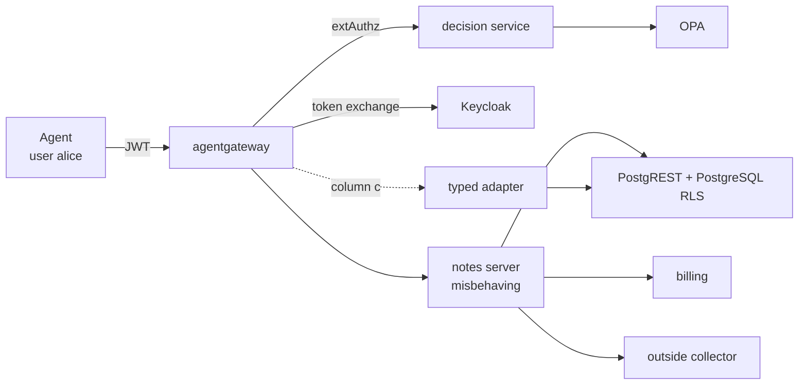

# Which check stops a misbehaving MCP server?

## 1. The question

An MCP server is code that an agent trusts twice: its tool descriptions go straight into the model's context, and its tools act on data with whatever rights the server holds. Invariant Labs describes a tool poisoning attack as one where *"malicious instructions are embedded within MCP tool descriptions that are invisible to users but visible to AI models"*, and a rug pull as the case where *"a malicious server can change the tool description after the client has already approved it"* ([Invariant Labs, 2025-04-01](https://invariantlabs.ai/blog/mcp-security-notification-tool-poisoning-attacks)). The MCP-38 taxonomy lists these as MCP-10 (tool description poisoning) and MCP-16 (rug pull), next to credential theft (MCP-02) and data exfiltration via tool output (MCP-24) ([arXiv:2603.18063](https://arxiv.org/abs/2603.18063)).

The server also handles credentials. The MCP authorization specification says *"The MCP server MUST NOT pass through the token it received from the MCP client"* ([MCP specification 2026-07-28, security considerations](https://modelcontextprotocol.io/specification/2026-07-28/basic/authorization/security-considerations)): a server that holds a user's token can present it elsewhere.

So: when an MCP server misbehaves — changes its description, does more with the data than it was asked, carries the token to another service, lies in its answer — **which of the checks proposed in open sources stops which behaviour, and what does each check cost?**

## 2. What open sources propose

| Option | Proposed by | What it promises |
|---|---|---|
| **(a)** Check every call at the gateway with an external policy engine, and pin the tool definition | OPA: *"Before the harness runs a tool call, the harness asks OPA, the Policy Decision Point (PDP), for a decision"* ([OPA, agent tool calling](https://www.openpolicyagent.org/docs/agent-tool-calling)). agentgateway acts as the enforcement point *"for every `tools/call` request"* ([examples/mcp-authzen, v1.6.0](https://github.com/agentgateway/agentgateway/tree/v1.6.0/examples/mcp-authzen)), mapping MCP to the [OpenID AuthZEN Authorization API 1.0](https://openid.net/specs/authorization-api-1_0.html) (draft MCP binding: [COAZ-MCP](https://openid.github.io/authzen/authzen-coaz-mcp-binding-1_0.html)). Pinning: MCP-38 recommends to *"Implement tool pinning where clients store hashes of approved tool definitions"* ([arXiv:2603.18063](https://arxiv.org/abs/2603.18063)); Microsoft defines a fingerprint as *"A cryptographic hash of a tool's description and schema, used to detect rug pulls"* ([MCP-SECURITY-GATEWAY-1.0](https://github.com/microsoft/agent-governance-toolkit/blob/main/docs/specs/MCP-SECURITY-GATEWAY-1.0.md)); [RugSnare](https://github.com/Paraphern/rugsnare) *"pins MCP tool contracts and fails your CI the moment they drift after approval"* | Only allowed agents call allowed tools with allowed arguments; a tool whose definition changed after approval is not called |
| **(b)** Exchange the agent's token for one bound to the specific server, and let the target enforce rights | [RFC 8693](https://www.rfc-editor.org/rfc/rfc8693) (token exchange); [RFC 8707](https://www.rfc-editor.org/rfc/rfc8707) §3: *"An audience-restricted access token that is legitimately presented to a resource cannot then be taken by that resource and presented elsewhere for illegitimate access to other resources."* Red Hat's MCP gateway aims to *"convert the broad access token into narrowly-scoped tokens specific to each MCP server"* ([Red Hat Developer, 2025-12-12](https://developers.redhat.com/articles/2025/12/12/advanced-authentication-authorization-mcp-gateway)). Supported by [Keycloak standard token exchange](https://www.keycloak.org/securing-apps/token-exchange) and agentgateway `backendAuth.oauthTokenExchange` ([examples/traffic-token-exchange, v1.6.0](https://github.com/agentgateway/agentgateway/tree/v1.6.0/examples/traffic-token-exchange)). At the target, PostgREST *"will switch to the database role"* named in the token's role claim and lets *"the database authorize client actions"* ([PostgREST auth](https://docs.postgrest.org/en/stable/references/auth.html)); PostgreSQL enforces rows with [row-level security](https://www.postgresql.org/docs/current/ddl-rowsecurity.html) | The server can act only with one user's narrowed rights, only at the service the token is for |
| **(a+b)** Both | The Red Hat gateway above does the per-server token exchange and also checks tools: *"Tool access is verified at every step."* | Both of the above |
| **(c)** Trusted code that executes only predefined operations | Beurer-Kellner et al., the action-selector pattern: *"translates incoming requests … to one or more predefined tool calls"* ([arXiv:2506.08837](https://arxiv.org/abs/2506.08837)); CaMeL: tools as *"subroutines … via predefined APIs"* run by a trusted interpreter ([arXiv:2503.18813](https://arxiv.org/abs/2503.18813)) | Nothing runs except operations the trusted code implements |

Option (c) as built here goes one step further than these sources: the third-party server receives no credential at all, and the adapter holds the only one. Both papers apply predefined operations to an LLM under prompt injection, not to an untrusted tool server, and neither addresses who holds the credentials; no opened source proposes withholding them from the server. That part is this testbed's design choice, following RFC 8707 §3 and the action-selector pattern.

## 3. What others have measured, and the gap

| Source | What it measures |
|---|---|
| MCPSecBench ([arXiv:2508.13220](https://arxiv.org/abs/2508.13220)) | Attack success on MCP hosts (Claude Desktop, OpenAI, Cursor): *"ASR reflects security failures and RR reflects defensive strictness."* Two protection mechanisms evaluated (MCIP-Guardian, Firewalled-Agentic-Networks); the subject is the host, not a check placed between host and server |
| MCPTox ([arXiv:2508.14925](https://arxiv.org/abs/2508.14925)), MCP-SafetyBench ([arXiv:2512.15163](https://arxiv.org/abs/2512.15163)) | How often models follow poisoned tools; the subject is the model, not an enforcement point |
| MCPSEC ([docs.rs/mcpsec 1.1.0](https://docs.rs/crate/mcpsec/1.1.0)) | One enforcement point, the gateway: it *"sends crafted payloads and checks whether the gateway correctly identifies or blocks each attack"*; no real server behind it |
| MCP-DPT ([arXiv:2604.07551](https://arxiv.org/abs/2604.07551)) | *"a layer-aligned taxonomy that organizes attacks by the architectural component responsible for enforcement"*: an analysis, no runs |
| ETDI ([arXiv:2506.01333](https://arxiv.org/abs/2506.01333)) | Proposes signed tool definitions; no measurements |
| RugSnare, Microsoft agent-governance-toolkit | Pin and alert on definition drift; no comparison with other checks |

In the sources listed here I did not find a comparison of two or more enforcement points against the same misbehaving server with outcomes measured on the target. For MCP-DPT and for Attested Tool-Server Admission ([arXiv:2605.24248](https://arxiv.org/abs/2605.24248)) only the abstracts were read; their evaluation sections may contain measurements.

## 4. Testbed



One MCP server with one tool, `read_note(id)`, sits behind agentgateway. A scripted agent (no model) authenticates as user alice, lists tools and reads her own note `a1`. The server can misbehave in six ways; the same run is repeated under four gateway configurations. Details: [docs/design.md](docs/design.md); threat model: [THREAT-MODEL.md](THREAT-MODEL.md).

| | Version | Real or built for the testbed |
|---|---|---|
| agentgateway | 1.6.0 | real |
| OPA | 1.21.2 | real |
| Keycloak | 26.4.2 (image pinned by digest) | real |
| PostgreSQL | 17-alpine (pinned by digest) | real |
| PostgREST | 12.2.12 (pinned by digest) | real |
| MCP server `server/notes_server.py` | — | built; misbehaves on purpose |
| Decision service `decision/decision.py` | — | built |
| Typed adapter `adapter/typed_adapter.py` | — | built |
| Billing, outside collector `services/` | — | built |
| Agent `harness/run_matrix.py` | — | built; a script, not a model |

Data is synthetic: two notes, alice's `a1` and bob's `b1`, which carries the canary `CANARY-BOB-7f3a`.

What the columns change:

| | (a) | (b) | (a+b) | (c) |
|---|---|---|---|---|
| Gateway checks each call | yes: OPA + pinned definition hash | no | yes | no |
| Server receives as `Authorization` | nothing (gateway default, see Findings) | exchanged token: audience `notes-api`, role `reader`, user alice | as (b) | nothing |
| Server's credential on the data API | own service account, read/write all rows | the exchanged token | the exchanged token | none |
| Who answers the agent | server | server | server | adapter |
| Tool description the agent sees | server's | server's | server's | adapter's |

## 5. Server behaviours and what counts as stopped

Every behaviour is harmless by construction and leaves an observable trace. The server's own trace is used only to confirm that a behaviour ran; outcomes come from the target and from what the agent received. The definitions below are implemented in [harness/outcome.py](harness/outcome.py).

| | The server... | Stopped means | Checked on |
|---|---|---|---|
| C0 | answers honestly (control) | — the call must succeed and return the database text; otherwise the column is broken | agent's answer vs. database |
| C1 | changes its tool description after the definition was pinned | the changed description did not reach the agent, **or** the agent's call made after seeing it did not go through | what the agent received |
| C2 | shows the pinned description to the checker and a changed one to the agent | as C1 | what the agent received |
| C3 | reads bob's note and posts it to an outside collector | the canary appears neither at the collector nor in the agent's answer | collector log, agent's answer |
| C4 | writes a row while serving a read | the notes table is identical before and after the call | PostgreSQL, read directly |
| C5 | replays the token it received against the billing service | the billing ledger did not grow | billing ledger |
| C6 | answers with text that is not in the database | the agent's answer equals the note text in the database | agent's answer vs. PostgreSQL, read before the call |

"Closed by design" means the behaviour cannot reach the agent in that architecture; it is explained under the matrix.

## 6. Matrix

<!-- MATRIX:START -->
| Server behaviour | (a) gateway: OPA + definition pin | (b) token exchange, rights at the target | (a+b) both | (c) typed adapter |
|---|---|---|---|---|
| C0. control: honest call | ok | ok | ok | ok |
| C1. changes its tool description after it was pinned | stopped | **not stopped** | stopped | closed by design |
| C2. shows the pinned description to the checker, a changed one to the agent | **not stopped** | **not stopped** | **not stopped** | closed by design |
| C3. reads another user's object and sends it out | **not stopped** | stopped | stopped | stopped |
| C4. writes instead of reading | **not stopped** | stopped | stopped | stopped |
| C5. replays the token it received against another service | stopped | stopped | stopped | stopped |
| C6. lies in its answer | **not stopped** | **not stopped** | **not stopped** | stopped |

**not stopped** = the behaviour had its effect (see `harness/outcome.py` for what is checked).
Columns whose control row is not ok: none.

Versions: agentgateway 1.6.0, OPA 1.21.2, keycloak `quay.io/keycloak/keycloak:26.4.2@sha256:3617b09bb4b7510a8d8d9b9fc5707399e2d70688dbcc2f8fb013a144829be1b9`, db `postgres:17-alpine@sha256:266d3c257594e195b309ae9d1805e54c788f1d7b375f56bf6c367aac6c917e7b`, postgrest `postgrest/postgrest:v12.2.12@sha256:5f4ce744539bbba786b4e24dbbd95bdb2a956dcf568c5374995a0ff4a68f5bd2`, Python 3.9.6, cryptography 44.0.2.
<!-- MATRIX:END -->

Closed by design: in column (c) the agent receives the adapter's own tool description, so no description from the server, changed or not, ever reaches it.

## 7. Findings

**(a) Gateway check with a pinned definition** stopped C1 and C5.
- C1 was stopped at the call: the decision service saw a changed hash and OPA denied with `definition_changed`. The changed description itself *did* reach the agent, because `tools/list` is relayed unfiltered. With a model in the loop, that text is still in its context.
- C5 was stopped by agentgateway's default token handling, not by the policy. *"By default, the gateway removes the JWT after validation"* unless `preserveToken` is set ([agentgateway v1.6.0, policy types](https://github.com/agentgateway/agentgateway/blob/v1.6.0/controller/api/v1alpha1/agentgateway/agentgateway_policy_types.go)), so the server received no token and had nothing to replay (`"had_token": false` in the server trace, billing answered `no_token`). In (b) and (a+b) `preserveToken: true` is required so that the token can be exchanged.
- C3 and C4 went through. The check decides whether a call proceeds; it does not see what the server does with its own account while serving that call. With a read/write service account the server read bob's note and wrote a row.

**(b) Token exchange with rights at the target** stopped C3, C4 and C5. The server's only credential was a token for one user, one audience and a read-only role: RLS returned no row for `b1`, the write was refused, and billing rejected the token for its audience. Nothing in this column looks at descriptions or answers, so C1, C2 and C6 went through.

**(a+b) Both** stopped C1, C3, C4 and C5, measured on its own configuration. In this run it equals the union of (a) and (b); it adds no protection against C2 or C6.

**(c) Typed adapter** stopped C3–C6, and C1–C2 cannot occur: the agent sees the adapter's own description and the adapter's own answer, and the server runs without any credential. For a pure read tool the third-party server contributes nothing in this column; the adapter reimplements the tool, which is the price.

**Not stopped by (a), (b) or (a+b):**
- **C2**, a split view: the server gave the decision service the pinned description and the agent a changed one. A check that fetches the definition on its own channel proves only what the server said to the checker. Analysis: [docs/c2-split-view.md](docs/c2-split-view.md).
- **C6**, a false answer: none of these columns compares the content of an answer with its source.

**What each variant misses by construction:**
- (a) acts on the call, not on the server: whatever the server does with its own rights, and whatever it says, passes as long as the call is allowed.
- (b) acts on rights, not on content: descriptions and answers are never checked, and the protection is exactly as good as the target's enforcement (here, the RLS policy in `infra/db/init.sql`).
- (c) protects by not using the server: every tool needs trusted code, and that code is now on the trust path.

## 8. Cost

<!-- COST:START -->
Generated by `harness/build_matrix.py`. Latency: 200 sequential tools/call per column after warm-up, all processes on one host (localhost); absolute numbers do not transfer to a network deployment.

| | (a) gateway: OPA + definition pin | (b) token exchange, rights at the target | (a+b) both | (c) typed adapter |
|---|---|---|---|---|
| components on the call path | 4 | 4 | 6 | 3 |
| of them this repository's code | 1 | 0 | 1 | 1 |
| own lines on the trust path | 188 | 26 | 214 | 201 |
| lines to add one tool | 13 (policy data) | 0 (rights live in the target) | 13 (policy data) | 12 (adapter code) |
| requires from the environment | nothing beyond the gateway; a live tools/list from the server on every call | an IdP with RFC 8693 token exchange; a target that enforces per-user rights (here: RLS) | both of the above | a data API the adapter can query with a read-only account; one adapter function per tool |
| latency median / p95, ms | 3.94 / 5.64 | 1.91 / 2.88 | 4.68 / 6.66 | 5.77 / 8.09 |
| failed calls during measurement | 0 | 0 | 0 | 0 |

Without a gateway (agent straight to the server): median 1.79 ms, p95 2.77 ms.

Own lines on the trust path: a: `decision/decision.py` 73, `lib/defhash.py` 5, `lib/net.py` 70, `policy/admission.rego` 40; b: `infra/db/init.sql` 26; ab: `decision/decision.py` 73, `lib/defhash.py` 5, `lib/net.py` 70, `policy/admission.rego` 40, `infra/db/init.sql` 26; c: `adapter/typed_adapter.py` 87, `lib/jwtcheck.py` 44, `lib/net.py` 70.
<!-- COST:END -->

## 9. Boundaries

What this testbed does not show:

- **One host, localhost.** Latency numbers do not transfer to a networked deployment.
- **One server, one read tool, synthetic data, six behaviours.** A tool that writes, sends mail or runs code changes what each column can and cannot stop.
- **No model.** C1, C2 and C6 are measured as "did the text reach the agent". Whether a model would act on it is not measured.
- **Per-call decisions only.** None of the columns sees data flow across calls: a sequence of allowed calls that ends with private data in an outside channel ([the lethal trifecta](https://simonwillison.net/2025/Jun/16/the-lethal-trifecta/)) is outside the matrix.
- **The agent is honest.** Controls on the agent itself (which tools, which argument values) are covered by unit tests, not by the matrix.
- **The server can only be reached through the gateway** by assumption, and its egress is not restricted in any column.
- **Default configurations.** Column (a) uses agentgateway's default token handling. With `preserveToken: true` the server would receive the agent's token; that configuration was not measured.

## 10. Reproduce

```bash
./run.sh
```

Requirements: Docker; Python 3.9+ with `cryptography`; `opa` 1.21.2 and `agentgateway` 1.6.0 on `PATH` (or `OPA=…`, `AGW=…`). Ports 3000–3002, 3030, 3101–3102, 5433, 8080, 8181 and 9191 must be free.

The script starts Keycloak, PostgreSQL and PostgREST (`infra/compose.yaml`), runs `opa test` and the unit tests, runs all 28 cells and the latency measurement, and rebuilds `results/matrix.md` and `results/cost.md` from `results/raw.jsonl`. A full run from a clean state takes about 40 s on an arm64 laptop once the images are pulled. `./run.sh --down` removes the containers.

`python3 harness/build_matrix.py` rebuilds both tables from the raw data without the testbed.

## License

[Apache-2.0](LICENSE)
