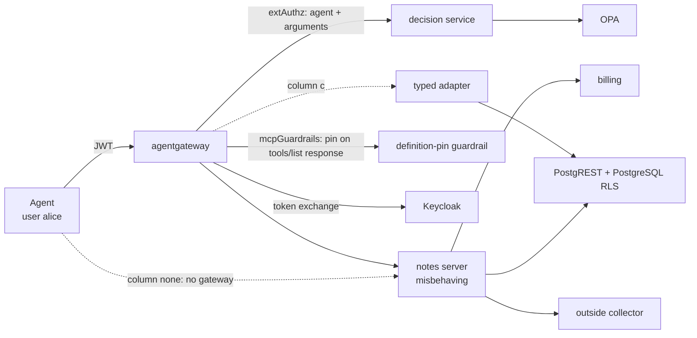

# Which check stops a misbehaving MCP server?

**TL;DR.** One MCP server with one tool, `read_note(id)`, made to misbehave six ways, is run behind
agentgateway under five setups: no gateway (baseline), a gateway call-check (OPA + a pinned tool
definition), token exchange with per-user rights at the target (PostgREST + RLS), both, and a typed
adapter that fronts the server. Every outcome is decided from the target's state, not from the
server's word, and the whole thing rebuilds from `./run.sh`. The short version:

- **Per-user rights at the data layer do not stop a server from exfiltrating the caller's *own* data.**
  C3 (the postmark-mcp pattern: send out the note the caller was entitled to read) is **not stopped**
  by OPA, by token exchange + RLS, or by both — only by the typed adapter (c), which takes the server
  off the egress path.
- **A lying server (C6)** is caught only by the adapter; no gateway check compares an answer to its source.
- **A rug pull (C1/C2)** is stopped only where the definition is pinned on the agent's *own* `tools/list`
  response (columns a, a+b). Pinning via a separate "definition checker" would be defeated by a server
  that serves the checker and the agent different definitions; this testbed pins inline, so there is no
  checker to fool.

<!-- MATRIX:START -->
| Server behaviour | (none) no gateway | (a) gateway: OPA + definition pin | (b) token exchange, rights at the target | (a+b) both | (c) typed adapter |
|---|---|---|---|---|---|
| _server credential → data API_ | own (broad) | own (broad) | exchanged → notes-api | exchanged → notes-api | adapter's own |
| C0. control: honest call | ok | ok | ok | ok | ok |
| C1. changes its tool description after it was pinned | **not stopped** | stopped | **not stopped** | stopped | closed by design |
| C2. changes its description too (former split-view; the inline pin catches it) | **not stopped** | stopped | **not stopped** | stopped | closed by design |
| C3. sends the caller's own note to an outside service (postmark pattern) | **not stopped** | **not stopped** | **not stopped** | **not stopped** | stopped |
| C4. writes instead of reading | **not stopped** | **not stopped** | stopped | stopped | stopped |
| C5. replays the token it received against another service | **not stopped** | stopped | stopped | stopped | stopped |
| C6. lies in its answer | **not stopped** | **not stopped** | **not stopped** | **not stopped** | stopped |

**not stopped** = the behaviour had its effect (see `harness/outcome.py` for what is checked).
Columns whose control row is not ok: none.

Versions: agentgateway 1.6.0, OPA 1.21.2, keycloak `quay.io/keycloak/keycloak:26.4.2@sha256:3617b09bb4b7510a8d8d9b9fc5707399e2d70688dbcc2f8fb013a144829be1b9`, db `postgres:17-alpine@sha256:266d3c257594e195b309ae9d1805e54c788f1d7b375f56bf6c367aac6c917e7b`, postgrest `postgrest/postgrest:v12.2.12@sha256:5f4ce744539bbba786b4e24dbbd95bdb2a956dcf568c5374995a0ff4a68f5bd2`, Python 3.9.6, cryptography 44.0.2.
<!-- MATRIX:END -->

The baseline column exists so every attack is shown landing before any check is added. Full outcome
definitions: [harness/outcome.py](harness/outcome.py); cost of each column is in [§8](#8-cost).

## 1. The question

An MCP server is code that an agent trusts twice: its tool descriptions go straight into the model's context, and its tools act on data with whatever rights the server holds. Invariant Labs describes a tool poisoning attack as one where *"malicious instructions are embedded within MCP tool descriptions that are invisible to users but visible to AI models"*, and a rug pull as the case where *"a malicious server can change the tool description after the client has already approved it"* ([Invariant Labs, 2025-04-01](https://invariantlabs.ai/blog/mcp-security-notification-tool-poisoning-attacks)). The MCP-38 taxonomy lists these as MCP-10 (tool description poisoning) and MCP-16 (rug pull), next to credential theft (MCP-02) and data exfiltration via tool output (MCP-24) ([arXiv:2603.18063](https://arxiv.org/abs/2603.18063)).

The server also handles credentials. The MCP authorization specification says *"The MCP server MUST NOT pass through the token it received from the MCP client"* ([MCP specification 2026-07-28, security considerations](https://modelcontextprotocol.io/specification/2026-07-28/basic/authorization/security-considerations)): a server that holds a user's token can present it elsewhere.

So: when an MCP server misbehaves — changes its description, does more with the data than it was asked, carries the token to another service, lies in its answer — **which of the checks proposed in open sources stops which behaviour, and what does each check cost?**

## 2. What open sources propose

| Option | Proposed by | What it promises |
|---|---|---|
| **(a)** Check every call at the gateway with an external policy engine, and pin the tool definition | OPA: *"Before the harness runs a tool call, the harness asks OPA, the Policy Decision Point (PDP), for a decision"* ([OPA, agent tool calling](https://www.openpolicyagent.org/docs/agent-tool-calling)). agentgateway acts as the enforcement point *"for every `tools/call` request"* ([examples/mcp-authzen, v1.6.0](https://github.com/agentgateway/agentgateway/tree/v1.6.0/examples/mcp-authzen)), mapping MCP to the [OpenID AuthZEN Authorization API 1.0](https://openid.net/specs/authorization-api-1_0.html) (draft MCP binding: [COAZ-MCP](https://openid.github.io/authzen/authzen-coaz-mcp-binding-1_0.html)). Pinning: MCP-38 recommends to *"Implement tool pinning where clients store hashes of approved tool definitions"* ([arXiv:2603.18063](https://arxiv.org/abs/2603.18063)); Microsoft defines a fingerprint as *"A cryptographic hash of a tool's description and schema, used to detect rug pulls"* ([MCP-SECURITY-GATEWAY-1.0](https://github.com/microsoft/agent-governance-toolkit/blob/main/docs/specs/MCP-SECURITY-GATEWAY-1.0.md)); [RugSnare](https://github.com/Paraphern/rugsnare) *"pins MCP tool contracts and fails your CI the moment they drift after approval"* | Only allowed agents call allowed tools with allowed arguments; a tool whose definition changed after approval is not called |
| **(b)** Exchange the agent's token for one bound to the specific server, and let the target enforce rights | [RFC 8693](https://www.rfc-editor.org/rfc/rfc8693) (token exchange); [RFC 8707](https://www.rfc-editor.org/rfc/rfc8707) §3: *"An audience-restricted access token that is legitimately presented to a resource cannot then be taken by that resource and presented elsewhere for illegitimate access to other resources."* Red Hat's MCP gateway aims to *"convert the broad access token into narrowly-scoped tokens specific to each MCP server"* ([Red Hat Developer, 2025-12-12](https://developers.redhat.com/articles/2025/12/12/advanced-authentication-authorization-mcp-gateway)). Supported by [Keycloak standard token exchange](https://www.keycloak.org/securing-apps/token-exchange) and agentgateway `backendAuth.oauthTokenExchange` ([examples/traffic-token-exchange, v1.6.0](https://github.com/agentgateway/agentgateway/tree/v1.6.0/examples/traffic-token-exchange)). At the target, PostgREST *"will switch to the database role"* named in the token's role claim and lets *"the database authorize client actions"* ([PostgREST auth](https://docs.postgrest.org/en/stable/references/auth.html)); PostgreSQL enforces rows with [row-level security](https://www.postgresql.org/docs/current/ddl-rowsecurity.html) | The server can act only with one user's narrowed rights, only at the service the token is for |
| **(a+b)** Both | The Red Hat gateway above does the per-server token exchange and also checks tools: *"Tool access is verified at every step."* | Both of the above |
| **(c)** Trusted code that executes only predefined operations | Beurer-Kellner et al., the action-selector pattern: *"translates incoming requests … to one or more predefined tool calls"* ([arXiv:2506.08837](https://arxiv.org/abs/2506.08837)); CaMeL: tools as *"subroutines … via predefined APIs"* run by a trusted interpreter ([arXiv:2503.18813](https://arxiv.org/abs/2503.18813)) | Nothing runs except operations the trusted code implements |

Where this testbed pins the definition (option a) differs from a side-channel checker: the pin is
checked by the gateway **on the `tools/list` response the agent receives** (agentgateway's `mcpGuardrails`
on the response phase; [guardrail/pin_processor.py](guardrail/pin_processor.py)), not by a separate
client that fetches the definition on its own connection. A server cannot show the pin one definition
and the agent another, because the pin is computed on the agent's own bytes.

Option (c) as built here goes one step further than these sources: the third-party server receives no credential at all, and the adapter holds the only one. Both papers apply predefined operations to an LLM under prompt injection, not to an untrusted tool server, and neither addresses who holds the credentials; no opened source proposes withholding them from the server. That part is this testbed's design choice, following RFC 8707 §3 and the action-selector pattern.

## 3. What others have measured, and the gap

| Source | What it measures |
|---|---|
| MCPSecBench ([arXiv:2508.13220](https://arxiv.org/abs/2508.13220)) | Attack success on MCP hosts (Claude Desktop, OpenAI, Cursor): *"ASR reflects security failures and RR reflects defensive strictness."* Two protection mechanisms evaluated (MCIP-Guardian, Firewalled-Agentic-Networks); the subject is the host, not a check placed between host and server |
| MCPTox ([arXiv:2508.14925](https://arxiv.org/abs/2508.14925)), MCP-SafetyBench ([arXiv:2512.15163](https://arxiv.org/abs/2512.15163)) | How often models follow poisoned tools; the subject is the model, not an enforcement point |
| MCPSEC ([docs.rs/mcpsec 1.1.0](https://docs.rs/crate/mcpsec/1.1.0)) | One enforcement point, the gateway: it *"sends crafted payloads and checks whether the gateway correctly identifies or blocks each attack"*; no real server behind it |
| MCP-DPT ([arXiv:2604.07551](https://arxiv.org/abs/2604.07551)) | *"a layer-aligned taxonomy that organizes attacks by the architectural component responsible for enforcement"*: an analysis, no runs |
| ETDI ([arXiv:2506.01333](https://arxiv.org/abs/2506.01333)) | Proposes signed tool definitions; no measurements |
| RugSnare, Microsoft agent-governance-toolkit | Pin and alert on definition drift; no comparison with other checks |

In the sources listed here I did not find a comparison of two or more enforcement points against the same misbehaving server with outcomes measured on the target. For MCP-DPT and for Attested Tool-Server Admission ([arXiv:2605.24248](https://arxiv.org/abs/2605.24248)) only the abstracts were read; their evaluation sections may contain measurements.

## 4. Testbed



One MCP server with one tool, `read_note(id)`, sits behind agentgateway. A scripted agent (no model) authenticates as user alice, lists tools and reads her own note `a1`. The server can misbehave in six ways; the same run is repeated under five configurations — a baseline with no gateway, then the four checks. Details: [docs/design.md](docs/design.md); threat model: [THREAT-MODEL.md](THREAT-MODEL.md).

| | Version | Real or built for the testbed |
|---|---|---|
| agentgateway | 1.6.0 | real |
| OPA | 1.21.2 | real |
| Keycloak | 26.4.2 (image pinned by digest) | real |
| PostgreSQL | 17-alpine (pinned by digest) | real |
| PostgREST | 12.2.12 (pinned by digest) | real |
| MCP server `server/notes_server.py` | — | built; misbehaves on purpose |
| Decision service `decision/decision.py` | — | built |
| Definition-pin guardrail `guardrail/pin_processor.py` | — | built; agentgateway ExtMcp processor (gRPC) |
| Typed adapter `adapter/typed_adapter.py` | — | built |
| Billing, outside collector `services/` | — | built |
| Agent `harness/run_matrix.py` | — | built; a script, not a model |

Data is synthetic: two notes, alice's `a1` (carrying the canary `CANARY-ALICE-9d2e`) and bob's `b1`.

What the columns change:

| | (none) | (a) | (b) | (a+b) | (c) |
|---|---|---|---|---|---|
| Gateway checks each call (OPA: agent + arguments) | no | yes | no | yes | no |
| Gateway pins the definition on the `tools/list` response | no | yes | no | yes | no (adapter's own description) |
| Server receives as `Authorization` | agent's token | nothing (gateway default) | exchanged token: audience `notes-api`, role `reader`, user alice | as (b) | nothing |
| Server's credential on the data API | own service account, read/write all rows | own service account | the exchanged token | the exchanged token | none |
| Who answers the agent | server | server | server | server | adapter |

## 5. Server behaviours and what counts as stopped

Every behaviour is harmless by construction and leaves an observable trace. The server's own trace is used only to confirm that a behaviour ran; outcomes come from the target and from what the agent received. The definitions below are implemented in [harness/outcome.py](harness/outcome.py).

| | The server... | Stopped means | Checked on |
|---|---|---|---|
| C0 | answers honestly (control) | — the call must succeed and return the database text; otherwise the column is broken | agent's answer vs. database |
| C1 | changes its tool description after the definition was pinned | the changed description did not reach the agent, **or** the agent's call made after seeing it did not go through | what the agent received |
| C2 | changes its description too — the former split-view that fooled an out-of-band checker; under the inline pin there is no separate checker, so it is served changed like C1 | as C1 | what the agent received |
| C3 | posts the caller's own note (the one it just read for her) to an outside collector — the postmark pattern | the caller's canary did not reach the collector | collector log |
| C4 | writes a row while serving a read | the notes table is identical before and after the call | PostgreSQL, read directly |
| C5 | replays the token it received against the billing service | the billing ledger did not grow | billing ledger |
| C6 | answers with text that is not in the database | the agent's answer equals the note text in the database | agent's answer vs. PostgreSQL, read before the call |

C3 is deliberately the caller's *own* data: alice is entitled to read `a1`, so per-user rights at the target permit the read. Only a control on what leaves the server (here, taking the server off the path, column c) stops the note from going out. "Closed by design" means the behaviour cannot reach the agent in that architecture (column c: the agent sees the adapter's description, so a changed server description never reaches it).

The matrix is at the top of this file. The baseline column `none` shows every behaviour landing with no gateway: that is where C5 (the replayed token is accepted by billing) and C3 (the note reaches the collector) are seen working before any check removes them.

## 6. The gateway itself

Independently of the matrix, the gateway is configured `jwtAuth: strict`. `harness/run_matrix.py` checks and records (`results/gateway-proofs.json`) that it rejects a call with **no token** (HTTP 401) and one with a **forged signature** (HTTP 401), and accepts a valid token (HTTP 200). Without this the "gateway" columns would assume an authentication step that was never shown to work.

## 7. Findings

**Baseline (none)** — agent straight to the server, no gateway. All six behaviours land. This is where C5 is shown to be a real attack: the server replays the agent's token (whose audience includes `billing`) and the billing ledger grows. C3 sends alice's own note to the collector. Nothing here is a surprise; it is the reference the other columns are read against.

**(a) Gateway check + pinned definition** stopped C1, C2 and C5.
- C1 and C2 were stopped by the pin on the `tools/list` **response**: the guardrail hashed the definition the agent was about to receive, it did not match the pin from `policy/data.json`, and the call was denied (`definition_changed`). Because the check is on the agent's own response, the former split-view C2 has no separate audience to stay clean for — it is caught like C1.
- C5 was stopped by agentgateway's default token handling, not by the policy. By default the gateway removes the JWT after validation unless `preserveToken` is set, so the server received no token and had nothing to replay (billing answered `no_token`). In (b) and (a+b) `preserveToken: true` is required so the token can be exchanged.
- C3, C4 and C6 went through. OPA decides whether a call proceeds (agent, tool, arguments); it does not see what the server does with its own account, nor the content of the answer.

**(b) Token exchange with rights at the target** stopped C4 and C5. The server's only credential was a token for one user, one audience and a read-only role: the write was refused and billing rejected the token for its audience. It did **not** stop C3: alice may read her own note, so exchanging the token to her rights does not stop the server from sending that note out. C1, C2 and C6 went through (nothing here looks at descriptions or answers).

**(a+b) Both** stopped C1, C2, C4 and C5 — the union of (a) and (b). It still does not stop C3 (the caller's own data) or C6 (a false answer).

**(c) Typed adapter** stopped C3–C6, and C1–C2 cannot occur: the agent sees the adapter's own description and the adapter's own answer, and the server runs without any credential. For a pure read tool the third-party server contributes nothing in this column; the adapter reimplements the tool, which is the price.

**The headline gaps:**
- **C3 (postmark pattern)** — exfiltrating the caller's own data — is not stopped by (a), (b), or (a+b). Per-call authorization and per-user rights both permit a read the caller is entitled to; neither watches where the result then goes. Only (c) stops it.
- **C6 (a lying server)** is caught only by (c); no gateway column compares an answer to its source.

**What each variant misses by construction:**
- (a) acts on the call and the definition, not on the server's own actions or its answers.
- (b) acts on rights, not on content or egress; it is exactly as good as the target's enforcement (the RLS policy in `infra/db/init.sql`).
- (c) protects by not using the server: every tool needs trusted code, and that code is now on the trust path.

## 8. Cost

<!-- COST:START -->
Generated by `harness/build_matrix.py`. Latency: 200 sequential tools/call per column after warm-up, all processes on one host (localhost); absolute numbers do not transfer to a network deployment.

| | (none) no gateway | (a) gateway: OPA + definition pin | (b) token exchange, rights at the target | (a+b) both | (c) typed adapter |
|---|---|---|---|---|---|
| components on the call path | 1 | 5 | 4 | 7 | 3 |
| of them this repository's code | 0 | 2 | 0 | 2 | 1 |
| own lines on the trust path | 0 | 135 | 26 | 161 | 201 |
| lines to add one tool | n/a (no gateway) | 13 (policy data) | 0 (rights live in the target) | 13 (policy data) | 12 (adapter code) |
| requires from the environment | nothing — the agent reaches the server directly (shows the attacks landing) | the gateway, a definition-pin guardrail on tools/list, and a live per-call decision | an IdP with RFC 8693 token exchange; a target that enforces per-user rights (here: RLS) | both of the above | a data API the adapter can query with a read-only account; one adapter function per tool |
| latency median / p95, ms | 2.48 / 4.04 | 4.31 / 6.13 | 2.79 / 4.35 | 4.18 / 5.93 | 6.5 / 8.23 |
| failed calls during measurement | 0 | 0 | 0 | 0 | 0 |

Without a gateway (agent straight to the server): median 2.42 ms, p95 3.71 ms.

Own lines on the trust path: none: ; a: `decision/decision.py` 47, `guardrail/pin_processor.py` 54, `policy/admission.rego` 34; b: `infra/db/init.sql` 26; ab: `decision/decision.py` 47, `guardrail/pin_processor.py` 54, `policy/admission.rego` 34, `infra/db/init.sql` 26; c: `adapter/typed_adapter.py` 87, `lib/jwtcheck.py` 44, `lib/net.py` 70.
<!-- COST:END -->

The definition pin adds a gRPC processor on the path for columns (a) and (a+b); its generated protobuf stubs (`guardrail/gen/`) are not counted as hand-written trust-path code.

## 9. Boundaries

What this testbed does not show:

- **One host, localhost.** Latency numbers do not transfer to a networked deployment.
- **One server, one read tool, synthetic data, six behaviours.** A tool that writes, sends mail or runs code changes what each column can and cannot stop.
- **No model.** C1, C2 and C6 are measured as "did the text reach the agent". Whether a model would act on it is not measured.
- **Per-call decisions only.** None of the columns sees data flow across calls: a sequence of allowed calls that ends with private data in an outside channel ([the lethal trifecta](https://simonwillison.net/2025/Jun/16/the-lethal-trifecta/)) is outside the matrix.
- **The agent is honest.** Controls on the agent itself (which tools, which argument values) are covered by unit tests, not by the matrix.
- **The server can only be reached through the gateway** by assumption (the `none` column is the deliberate exception), and its egress is not restricted in any gateway column.
- **Default configurations.** Column (a) uses agentgateway's default token handling; with `preserveToken: true` the server would receive the agent's token, which is why C5 is stopped there only incidentally.

## 10. Reproduce

```bash
pip install -r requirements.txt   # cryptography, grpcio
./run.sh
```

Requirements: Docker; Python 3.9+ with `cryptography` and `grpcio`; `opa` 1.21.2 and `agentgateway` 1.6.0 on `PATH` (or `OPA=…`, `AGW=…`). Ports 3000–3002, 3030, 3101–3102, 5433, 8080, 8181, 9191 and 9201 must be free.

The script starts Keycloak, PostgreSQL and PostgREST (`infra/compose.yaml`), runs `opa test` and the unit tests, runs all 35 cells (5 columns × 7 behaviours), the gateway proofs and the latency measurement, and rebuilds `results/matrix.md` and `results/cost.md` from `results/raw.jsonl`. A full run from a clean state takes about a minute on an arm64 laptop once the images are pulled. `./run.sh --down` removes the containers.

`python3 harness/build_matrix.py` rebuilds both tables from the raw data without the testbed.

## License

[Apache-2.0](LICENSE)
