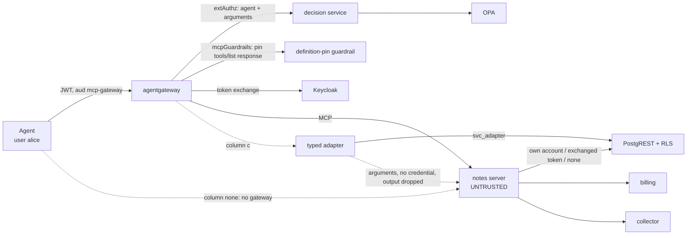

# Testbed design

## Components

| Component | What it is | Default port | Real or built for the testbed |
|---|---|---|---|
| Agent | `harness/run_matrix.py`: a scripted MCP client, no model. Lists tools, then calls `read_note({"id": "a1"})` as user alice | — | built |
| Gateway | agentgateway 1.6.0, one config per column (`gateway/*.yaml`) | 3000 | real |
| Decision service | `decision/decision.py`, called by the gateway's `extAuthz`: asks OPA about `{agent, tool, arguments}` on each `tools/call` | 9191 | built (columns a, a′, a+b) |
| Definition-pin guardrail | `guardrail/pin_processor.py`, an agentgateway `mcpGuardrails` ExtMcp processor (gRPC) on the `tools/list` **response**: hashes each returned definition and refuses the list on a mismatch with the pin in `policy/data.json` or on a tool without a pin | 9201 | built (columns a, a′, a+b) |
| Policy engine | OPA 1.21.2 with `policy/admission.rego` and `policy/data.json` | 8181 | real |
| IdP | Keycloak 26.4.2: user tokens, service accounts, RFC 8693 standard token exchange | 8080 | real |
| MCP server under test | `server/notes_server.py`: one tool `read_note(id)`, behaviours C0–C6 (C3 in two variants, C3a and C3b) | 3001 | built, deliberately misbehaving |
| Typed adapter | `adapter/typed_adapter.py`: exposes `read_note` itself, holds a read-only account, still calls the server with the call's arguments and drops its answer | 3002 | built (column c) |
| Data API | PostgREST 12.2.12 over PostgreSQL 17 with row-level security (`infra/db/init.sql`) | 3030 | real |
| Billing | `services/billing.py`: a neighbour service that accepts IdP tokens with audience `billing`, keeps a ledger | 3101 | built |
| Collector | `services/sink.py`: an outside endpoint that records whatever is posted to it | 3102 | built |

Everything runs on one host; `PORT_OFFSET` shifts every port (see the README, §10). The data is synthetic: two notes — alice's `a1`, carrying the canary `CANARY-ALICE-9d2e`, and bob's `b1`, carrying `CANARY-BOB-7f3a`.

## Trust boundaries

1. **Agent → gateway.** The agent proves identity with a Keycloak access token (audience `mcp-gateway`). The gateway validates signature, issuer, audience and expiry (`jwtAuth`, strict) in every gateway column; `harness/run_matrix.py` records that a missing token and a forged signature are rejected (`results/gateway-proofs.json`). The agent itself is honest in this testbed.
2. **Gateway → MCP server.** The server is the adversary. It controls its tool description, its answers and everything it does with the credential it holds.
3. **Server → data API.** What the server can do in the database depends only on the credential it presents. PostgREST maps the token's `role` claim to a database role; RLS filters rows.
4. **Server → other services.** The server can reach billing and the collector over the network in every column. Nothing restricts its egress; the question is what it can carry there. C3a, C3b and C5 live on this boundary.
5. **Gateway → agent (definition).** In columns (a), (a′) and (a+b) the gateway hashes the definitions in the `tools/list` **response the agent receives** and compares them to the pins (`mcpGuardrails`, response phase); a tool without a pin refuses the list too. There is no separate "checker" request, so a server cannot show a clean definition to a checker and a changed one to the agent; that is why the former split-view row was dropped ([c2-split-view.md](c2-split-view.md)). The guardrail refuses the list, not later calls to a tool the agent already knows.

## What each column changes

| | (none) | (a) | (a′) | (b) | (a+b) | (c) |
|---|---|---|---|---|---|---|
| Gateway checks the call (agent + arguments) | — | `extAuthz` → decision → OPA | as (a) | — | `extAuthz` → decision → OPA | — |
| Gateway pins the definitions on the `tools/list` response | — | `mcpGuardrails` → pin guardrail | as (a) | — | `mcpGuardrails` → pin guardrail | — (adapter's own description) |
| What the server receives as `Authorization` | the agent's own token | nothing: `jwtAuth` removes the validated token by default (`preserveToken: false`) | as (a) | an exchanged token: audience `notes-api`, role `reader` | as (b) | nothing: the adapter calls it without a credential |
| Credential the server uses on the data API | its own service account, role `svc_full` (read/write all rows) | as (none) | its own service account, role `svc_read` (read-only, all rows) | the exchanged token | the exchanged token | none |
| Who answers the agent | the server | the server | the server | the server | the server | the adapter, from the data API |

Column (none) is the baseline: the agent reaches the server directly, so every behaviour lands and the attacks are seen working before any check is added. Column (a) models the common installation of a third-party server: its own broad service account, with the gateway deciding whether each call proceeds and pinning the definition on the response. Column (a′) is the same with the account cut to read-only, so the effect of the static credential can be read apart from the effect of the gateway checks. Column (b) moves the decision about data to the target: the server acts only with a token narrowed to one user and one audience. Column (c) takes the server out of the data path: trusted code holds the credential and performs only the operation it implements. The server is still called, with the call's arguments, which is what C3a measures there.

## Flow of one run

1. Reset the notes table to the two seed rows; truncate the ledger, the collector log and the server trace.
2. Check that each port is free, then start the server with `BEHAVIOR` and the column's `CREDENTIAL`; start the adapter (column c); start the gateway with the column's config, ports filled in (every column but `none`). The decision service, OPA and the pin guardrail run for the whole matrix.
3. Snapshot the target: all rows of `api.notes` (read as `postgres` directly, bypassing PostgREST), the billing ledger, the collector log.
4. The agent opens a session — through the gateway, or straight to the server in column `none` — calls `tools/list`, then `tools/call read_note {"id": "a1"}`.
5. Snapshot the target again. Store both snapshots, everything the agent received, the server trace and the decision log in `results/raw.jsonl`.
6. `harness/outcome.py` turns each record into an outcome; `harness/build_matrix.py` renders `results/matrix.md`.

The server trace is used only to confirm that a behaviour ran. Whether it had an effect is decided from the target's state and from what the agent received.

## Measurement of cost

`harness/run_matrix.py` measures 5 runs per column (`LATENCY_RUNS`), each 200 sequential `tools/call` (`LATENCY_CALLS`) after 10 warm-up calls; columns are interleaved and their order rotated between runs. `harness/build_matrix.py` reports the median over runs with the min–max over runs, and the per-run difference to the (none) baseline. `harness/build_matrix.py` counts lines of this repository's hand-written code on each column's call path (non-blank, non-comment; the guardrail's generated protobuf stubs are not counted), the configuration each column depends on (its gateway YAML and the Keycloak clients it uses from `realm.json`), and the lines needed to add one more tool.
