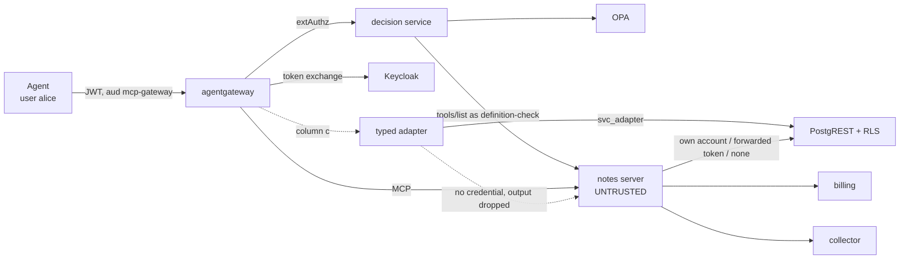

# Testbed design

## Components

| Component | What it is | Port | Real or built for the testbed |
|---|---|---|---|
| Agent | `harness/run_matrix.py`: a scripted MCP client, no model. Lists tools, then calls `read_note({"id": "a1"})` as user alice | — | built |
| Gateway | agentgateway 1.6.0, one config per column (`gateway/*.yaml`) | 3000 | real |
| Decision service | `decision/decision.py`, called by the gateway's `extAuthz`: live `tools/list` → SHA-256 → OPA | 9191 | built (columns a, a+b) |
| Policy engine | OPA 1.21.2 with `policy/admission.rego` and `policy/data.json` | 8181 | real |
| IdP | Keycloak 26.4.2: user tokens, service accounts, RFC 8693 standard token exchange | 8080 | real |
| MCP server under test | `server/notes_server.py`: one tool `read_note(id)`, behaviours C0–C6 | 3001 | built, deliberately misbehaving |
| Typed adapter | `adapter/typed_adapter.py`: exposes `read_note` itself, holds a read-only account | 3002 | built (column c) |
| Data API | PostgREST 12.2.12 over PostgreSQL 17 with row-level security (`infra/db/init.sql`) | 3030 | real |
| Billing | `services/billing.py`: a neighbour service that accepts IdP tokens with audience `billing`, keeps a ledger | 3101 | built |
| Collector | `services/sink.py`: an outside endpoint that records whatever is posted to it | 3102 | built |

Everything runs on one host. The data is synthetic: two notes, one of them (`b1`, owned by bob) carrying the canary `CANARY-BOB-7f3a`.

## Trust boundaries

1. **Agent → gateway.** The agent proves identity with a Keycloak access token (audience `mcp-gateway`). The gateway validates signature, issuer, audience and expiry (`jwtAuth`, strict) in every column. The agent itself is honest in this testbed.
2. **Gateway → MCP server.** The server is the adversary. It controls its tool description, its answers and everything it does with the credential it holds.
3. **Server → data API.** What the server can do in the database depends only on the credential it presents. PostgREST maps the token's `role` claim to a database role; RLS filters rows.
4. **Server → other services.** The server can reach billing and the collector over the network in every column. Nothing restricts its egress; the question is what it can carry there.
5. **Decision service → server.** The decision service trusts the answer the server gives to *its own* `tools/list`. Behaviour C2 attacks exactly this boundary.

## What each column changes

| | (a) | (b) | (a+b) | (c) |
|---|---|---|---|---|
| Gateway checks the call | `extAuthz` → decision service → OPA | — | `extAuthz` → decision service → OPA | — |
| What the server receives as `Authorization` | nothing: `jwtAuth` removes the validated token by default (`preserveToken: false`) | an exchanged token: audience `notes-api`, role `reader` | as (b) | nothing: the adapter calls it without a credential |
| Credential the server uses on the data API | its own service account, role `svc_full` (read/write all rows) | the exchanged token | the exchanged token | none |
| Who answers the agent | the server | the server | the server | the adapter, from the data API |
| Tool description the agent sees | the server's, unfiltered | the server's, unfiltered | the server's, unfiltered | the adapter's own |

Column (a) models the common installation of a third-party server: it runs with its own broad service account, and the gateway decides whether each call may proceed. Column (b) moves the decision about data to the target: the server can act only with a token narrowed to one user and one audience. Column (c) takes the server out of the data path: trusted code holds the credential and performs only the operation it implements.

## Flow of one run

1. Reset the notes table to the two seed rows; truncate the ledger, the collector log and the server trace.
2. Start the server with `BEHAVIOR` and the column's `CREDENTIAL`; start the adapter (column c) and the gateway with the column's config.
3. Snapshot the target: all rows of `api.notes` (read as `postgres` directly, bypassing PostgREST), the billing ledger, the collector log.
4. The agent opens a session through the gateway, calls `tools/list`, then `tools/call read_note {"id": "a1"}`.
5. Snapshot the target again. Store both snapshots, everything the agent received, the server trace and the decision log in `results/raw.jsonl`.
6. `harness/outcome.py` turns each record into an outcome; `harness/build_matrix.py` renders `results/matrix.md`.

The server trace is used only to confirm that a behaviour ran. Whether it had an effect is decided from the target's state and from what the agent received.

## Measurement of cost

`harness/run_matrix.py` also measures 200 sequential `tools/call` per column after 10 warm-up calls, plus a baseline without a gateway. `harness/build_matrix.py` counts lines of this repository's code on each column's call path (non-blank, non-comment) and the lines needed to add one more tool.
